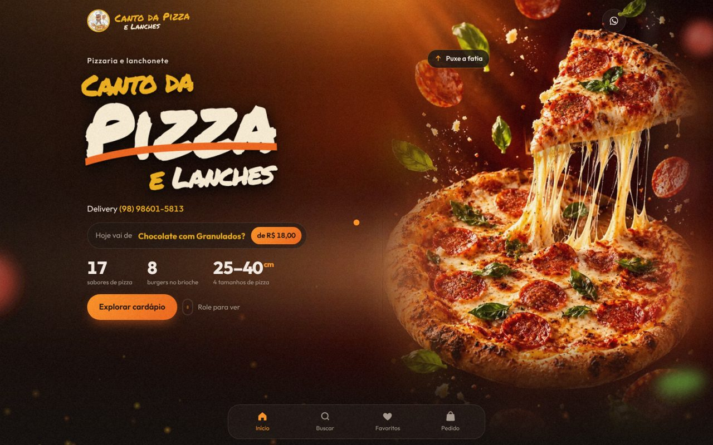
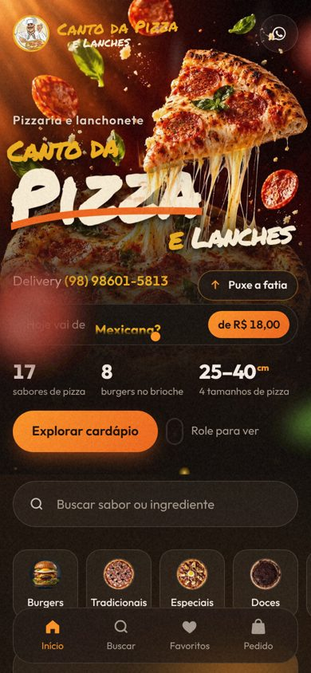

# 🍕 Canto da Pizza e Lanches: Cardápio Digital

Cardápio digital com pedido pelo WhatsApp para uma pizzaria e hamburgueria de Barreirinhas (MA). O projeto substituiu o cardápio impresso por uma experiência rápida, pensada primeiro para o celular.

**🔗 Ao vivo:** [cantodapizza.netlify.app](https://cantodapizza.netlify.app/)

<p align="center">
  
  
</p>

## O problema

O cardápio era de papel, e cada pedido virava uma conversa longa no WhatsApp para tirar dúvidas sobre sabor, tamanho e preço.

## A solução

- **Catálogo completo:** 17 sabores de pizza em 4 tamanhos (25 a 40 cm), 8 burgers no pão brioche, pizzas doces e porções
- **Busca, favoritos e navegação por categorias**, com barra inferior no estilo de aplicativo
- **Carrinho com total em tempo real** e envio do pedido já formatado para o WhatsApp da loja
- **Animações nos destaques:** pizza que se "puxa" na abertura e camadas do burger que se separam
- **Fotos reais dos produtos**, ampliadas com IA (Real-ESRGAN) para ganhar nitidez
- **Performance:** o DOM caiu de ~6.400 para ~1.400 nós, com lazy-loading de imagens e fontes e scripts hospedados no próprio site
- **SEO:** título, descrição e tags Open Graph para busca e compartilhamento
- **Testes automatizados** com Playwright em desktop e celular: toque, rolagem, carrinho e checkout

## Stack

`HTML5` · `CSS3` · `JavaScript` · `Lenis (smooth scroll)` · `Playwright` · `Netlify`

## Rodar localmente

```bash
git clone https://github.com/GustavoPires275/Web-site-Canto-da-Pizza.git
cd Web-site-Canto-da-Pizza
python3 -m http.server 8000   # ou qualquer servidor estático
```

---

Desenvolvido por **Gustavo Pires**: sites, sistemas e automações para negócios reais.
